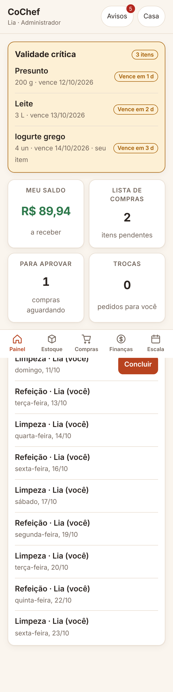
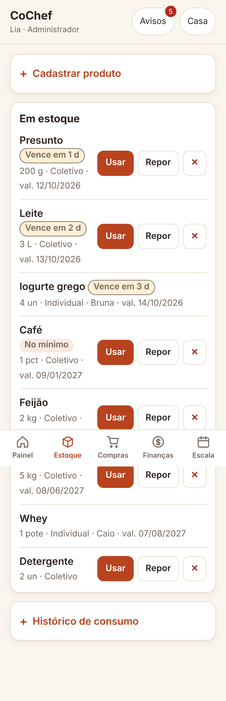
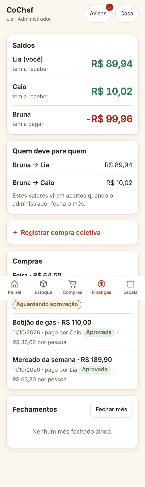

# Estratégia de testes e evidências de qualidade

## 1. Estratégia

O objetivo dos testes é responder a uma pergunta: **o código faz o que a [spec.md](../spec.md) diz?** Por isso cada teste carrega no nome o identificador do requisito que verifica, e a [matriz de rastreabilidade](../spec.md#9-rastreabilidade) liga os dois.

| Nível | O que cobre | Como | Arquivos |
| :--- | :--- | :--- | :--- |
| **Unidade** | Regras puras: rateio, acerto, validade, rodízio, datas, hash de senha, token | Funções chamadas diretamente, com casos de borda e propriedades (por exemplo: a soma das cotas é igual ao valor para todo valor e tamanho de casa testados) | `tests/dominio.test.ts` |
| **Integração ponta a ponta na API** | Todos os requisitos funcionais, as permissões por perfil e os fluxos de exceção | Cada teste sobe a aplicação inteira (HTTP, serviços e SQLite em memória) com relógio fixo e faz as chamadas que a interface faria | `tests/auth.test.ts`, `estoque.test.ts`, `financas.test.ts`, `escala.test.ts` |
| **Abuso** | Sem token, token adulterado ou expirado, outra república, perfil insuficiente, entrada malformada, injeção de SQL, travessia de diretório, excesso de tentativas | Idem, com entradas hostis | `tests/auth.test.ts` |
| **Desempenho** | RNF-01 | Carga de 2.000 produtos e 500 compras; mede as consultas de estoque, saldo, painel e compras | `tests/estoque.test.ts` |
| **Interface** | RNF-04 e funcionamento das telas | Inspeção em navegador a 360 px e 1280 px: todas as telas, sem erro de console, sem rolagem horizontal, sem conteúdo cortado | [evidências](evidencias/) |

**Princípios**

- **O tempo é controlado.** Validade, escala e fechamento dependem de "hoje"; os testes usam um relógio injetado e avançam os dias explicitamente. Nenhum teste depende da data em que roda.
- **Cada regra é testada pelos dois lados:** o caminho permitido e o bloqueado. Nos bloqueios, o teste também confere que nada mudou (estoque intacto, saldos zerados).
- **Os limites são testados no limite:** 3 dias é validade crítica e 4 não é; no dia do vencimento ainda se consome e no dia seguinte não; no mínimo de estoque a sugestão entra e uma unidade acima não.
- **Sem dublês do banco.** Os testes de integração usam SQLite real em memória, então as restrições do esquema também são exercitadas.

**O que não é testado automaticamente:** a interface (inspeção manual; automatizar é a tarefa T-50), a disponibilidade de 99% do RNF-03 (só mensurável em operação) e a igualdade de tempo de resposta do login para e-mail existente e inexistente.

## 2. Como executar

```bash
npm test                 # suíte completa
npm run test:cobertura   # suíte com relatório de cobertura
npm run typecheck        # verificação de tipos (requer npm install)
```

## 3. Resultado

Execução de 11/10/2026, Node.js 22.22: **84 testes em 12 suítes, 84 aprovados, 0 reprovados.** Verificação de tipos sem erros.

Cobertura do código em `src/`: **97.38% das linhas, 91.03% dos desvios, 96.86% das funções.**

### Cobertura por arquivo

```
--------------------------------------------------------------------------------------
file              | line % | branch % | funcs % | uncovered lines
--------------------------------------------------------------------------------------
src               |        |          |         |
 db.ts            | 100.00 |    75.00 |  100.00 |
 dominio          |        |          |         |
  acerto.ts       | 100.00 |   100.00 |  100.00 |
  datas.ts        | 100.00 |   100.00 |  100.00 |
  escala.ts       | 100.00 |    75.00 |  100.00 |
  rateio.ts       |  76.92 |    90.91 |  100.00 | 19-24
  validade.ts     | 100.00 |   100.00 |  100.00 |
 erros.ts         | 100.00 |   100.00 |  100.00 |
 http             |        |          |         |
  app.ts          |  90.06 |    79.69 |  100.00 | 43-46 53-54 124-125 155-160 164-166
  rotas.ts        |  97.33 |    90.00 |   94.74 | 141-142 145-146
  roteador.ts     | 100.00 |   100.00 |  100.00 |
 relogio.ts       |  77.42 |   100.00 |   83.33 | 12-18
 seguranca        |        |          |         |
  senha.ts        | 100.00 |    94.12 |  100.00 |
  token.ts        |  95.00 |    80.00 |  100.00 | 38-39
 servicos         |        |          |         |
  auth.ts         | 100.00 |   100.00 |  100.00 |
  contexto.ts     | 100.00 |   100.00 |  100.00 |
  escala.ts       | 100.00 |    94.59 |  100.00 |
  estoque.ts      |  98.38 |    82.93 |  100.00 | 152-154
  financas.ts     |  99.11 |    94.87 |  100.00 | 44-45
  lista.ts        | 100.00 |    86.67 |  100.00 |
  notificacoes.ts |  89.36 |   100.00 |   71.43 | 41-43 46-47
  painel.ts       | 100.00 |    90.91 |   83.33 |
  republica.ts    | 100.00 |   100.00 |  100.00 |
  rotinas.ts      |  93.55 |    88.89 |   66.67 | 59-62
 validacao.ts     | 100.00 |    95.12 |  100.00 |
--------------------------------------------------------------------------------------
all files         |  97.38 |    91.03 |   96.86 |
--------------------------------------------------------------------------------------
```

As linhas não cobertas são principalmente: o relógio real (substituído por um relógio fixo nos testes), a varredura de todas as repúblicas feita pelo agendador, o ramo de rateio em que o pagador não participa da divisão (inalcançável pela API, que exige pagador ativo), a marcação individual de notificação como lida e os ramos de erro de leitura do corpo da requisição. `config.ts` e `servidor.ts` não aparecem na tabela porque os testes montam a aplicação sem eles.

### Desempenho (RNF-01)

| Consulta | Medido | Limite |
| :--- | ---: | ---: |
| `GET /api/produtos` (2.000 itens) | 16 ms | 1.500 ms |
| `GET /api/balanco` (500 compras) | 2 ms | 1.500 ms |
| `GET /api/painel` | 15 ms | 1.500 ms |
| `GET /api/compras` | 7 ms | 1.500 ms |

Os tempos variam alguns milissegundos entre execuções; o teste imprime os valores a cada rodada.

### Interface (RNF-04)

| 360 px | 360 px | 360 px |
| :---: | :---: | :---: |
|  |  |  |

Capturas de página inteira; a barra de abas, que na tela fica fixa no rodapé, aparece no meio da imagem por causa do modo de captura. Escala em 1280 px: [escala-1280px.png](evidencias/escala-1280px.png).

### Saída completa dos testes

```
▶ Autenticação, perfis e isolamento
  ✔ quem cria a república vira ADMIN; quem entra por convite vira MORADOR
  ✔ cadastro exige exatamente um entre nome da república e convite, e-mail válido e senha de 8+ caracteres
  ✔ e-mail não pode ser reutilizado (nem mudando maiúsculas)
  ✔ RNF-02: a senha nunca é gravada em claro e nunca é devolvida pela API
  ✔ login: senha errada e e-mail inexistente dão a mesma resposta
  ✔ RNF-02: toda rota privada exige token válido
  ✔ token expira
  ✔ isolamento: uma república não enxerga nem altera dados de outra
  ✔ morador comum não acessa funções de administrador
  ✔ entradas malformadas são recusadas com 4xx, nunca 500
  ✔ alvo de requisição malformado devolve 400 e não derruba o servidor
  ✔ injeção de SQL em campos de texto é tratada como texto
  ✔ cabeçalhos de segurança e proteção contra travessia de diretório
✔ Autenticação, perfis e isolamento
▶ Limite de tentativas de autenticação
  ✔ após o limite, novas tentativas recebem 429
✔ Limite de tentativas de autenticação
▶ datas
  ✔ valida datas de calendário, inclusive inexistentes
  ✔ soma e diferença atravessam mês e ano bissexto
✔ datas
▶ RF-03 / glossário: Validade Crítica (3 dias ou menos)
  ✔ 4 dias para vencer ainda é OK
  ✔ exatamente 3 dias já é crítica
  ✔ vence hoje: crítica e ainda consumível
  ✔ RB-04: venceu ontem é vencida
  ✔ produto sem validade nunca entra em alerta
✔ RF-03 / glossário: Validade Crítica (3 dias ou menos)
▶ RB-02 / RB-05: rateio igualitário
  ✔ divisão exata gera cotas idênticas
  ✔ RB-05: centavos residuais ficam com o pagador e a soma fecha no valor da compra
  ✔ a soma das cotas sempre é igual ao valor, para qualquer valor e tamanho de casa
  ✔ rejeita valor não inteiro, não positivo ou casa sem moradores
✔ RB-02 / RB-05: rateio igualitário
▶ RB-03: compensação de saldos em transferências
  ✔ um credor e dois devedores
  ✔ gera no máximo n-1 transferências e zera todos os saldos
  ✔ saldos zerados não geram transferência
  ✔ saldos que não fecham em zero indicam corrupção e são rejeitados
✔ RB-03: compensação de saldos em transferências
▶ RF-11: rodízio da escala
  ✔ percorre os moradores em ordem e recomeça
  ✔ continua depois do último responsável da escala anterior
  ✔ se o último responsável saiu da casa, segue o próximo por ordem
✔ RF-11: rodízio da escala
▶ RNF-02: senha e token
  ✔ hash usa scrypt com salt aleatório: mesma senha, hashes diferentes
  ✔ hash malformado ou com custo absurdo é recusado sem estourar
  ✔ token válido devolve o usuário; expirado, adulterado ou de outro segredo, não
  ✔ token com "alg: none" é recusado
✔ RNF-02: senha e token
▶ Escala de tarefas e gestão de moradores
  ✔ RF-11: escala gerada é rotativa entre os moradores ativos
  ✔ RF-11: limpeza e refeição do mesmo dia caem com pessoas diferentes
  ✔ RF-11: gerar de novo não duplica turnos e continua o rodízio de onde parou
  ✔ RF-11: não gera escala no passado nem com parâmetros fora do limite
  ✔ conclusão de turno: só o responsável, só a partir do dia marcado, uma única vez
  ✔ turno de hoje pendente gera lembrete ao responsável; turno passado pendente aparece como atrasado
  ✔ RF-06: troca solicitada e aceita registra a substituição e atualiza o calendário
  ✔ RF-06: recusa e cancelamento mantêm a escala como estava
  ✔ RF-06: regras do pedido — turno próprio, de outra pessoa, pendente, não passado e sem pedido em aberto
  ✔ RF-06: aceite tardio de troca cujo turno já passou cancela o pedido
  ✔ RF-12 / RB-06: a república nunca fica sem administrador ativo
  ✔ RF-12 / RB-07: morador com saldo em aberto não pode ser desativado
  ✔ RB-07: morador com compra aguardando aprovação também não pode ser desativado
  ✔ RF-12: desativar encerra o acesso na hora, tira o morador da escala futura e do rodízio seguinte
  ✔ convite regenerado invalida o código anterior
✔ Escala de tarefas e gestão de moradores
▶ Estoque, validade e lista de compras
  ✔ RF-01: cadastro registra nome, quantidade, validade e classificação
  ✔ RF-01 / RB-01: item individual pertence a quem cadastrou
  ✔ RF-01: não aceita produto já vencido nem mínimo em item individual
  ✔ RF-02: consumo decrementa o estoque e entra no histórico
  ✔ RF-02: não permite consumir mais do que há; ao zerar, produto fica ESGOTADO
  ✔ RF-07 / RB-01: baixa em item individual alheio é bloqueada com mensagem de propriedade, inclusive para o admin
  ✔ RB-01: outro morador também não edita, repõe nem descarta item individual alheio
  ✔ RF-03: produto a 3 dias ou menos do vencimento aparece em destaque no painel e notifica os moradores
  ✔ RF-03: o alerta acompanha o estado — surge quando o prazo se aproxima e some quando o produto é consumido
  ✔ RF-03: validade crítica de item individual só notifica o dono
  ✔ RB-04: passada a validade, o produto vira VENCIDO, sai do estoque ativo e não pode ser consumido
  ✔ RF-04: ao atingir a quantidade mínima, o item coletivo entra sozinho na lista de compras, uma única vez
  ✔ RF-04: item individual nunca vai para a lista coletiva; coletivo sem mínimo também não
  ✔ RF-04 + reposição: repor acima do mínimo dá baixa na sugestão e reativa o produto
  ✔ reposição de produto vencido substitui o lote e exige nova validade
  ✔ lista de compras manual: adicionar, marcar comprado e permissões de remoção
  ✔ descarte de item coletivo: só quem cadastrou ou o admin
✔ Estoque, validade e lista de compras
▶ RNF-01: desempenho das consultas
  ✔ estoque com 2.000 produtos e finanças com 500 compras respondem em menos de 1,5 s
✔ RNF-01: desempenho das consultas
▶ Compras coletivas, rateio e acerto
  ✔ RF-05 / RB-02: compra registrada pelo admin é rateada em partes iguais entre os moradores ativos
  ✔ RB-05: divisão inexata — o resíduo fica com o pagador e os saldos somam zero
  ✔ RF-08: compra registrada por morador fica PENDENTE, não altera saldos e avisa o admin
  ✔ RF-08: só o admin aprova; a aprovação lança o rateio e notifica quem registrou
  ✔ RF-08: rejeição exige motivo e não gera rateio
  ✔ RB-02: o rateio considera quem está ativo no momento do lançamento
  ✔ RB-03: o que o morador paga abate primeiro a dívida que ele já tinha
  ✔ RF-05: validações — valor positivo, data não futura, pagador ativo da própria casa
  ✔ "quem deve para quem": transferências sugeridas zeram os saldos
  ✔ RF-09: fechamento gera os acertos, notifica devedores e congela o mês
  ✔ RF-09: não fecha mês futuro nem com compra pendente
  ✔ RF-08 + RF-09: compra pendente de mês já fechado não pode mais ser aprovada
  ✔ RF-10: quem recebe (ou o admin) confirma o pagamento; o devedor não; o saldo é zerado
  ✔ RF-09: novo fechamento substitui acertos ainda pendentes do anterior, sem cobrar em dobro
  ✔ ações financeiras ficam na trilha de auditoria
✔ Compras coletivas, rateio e acerto
```
