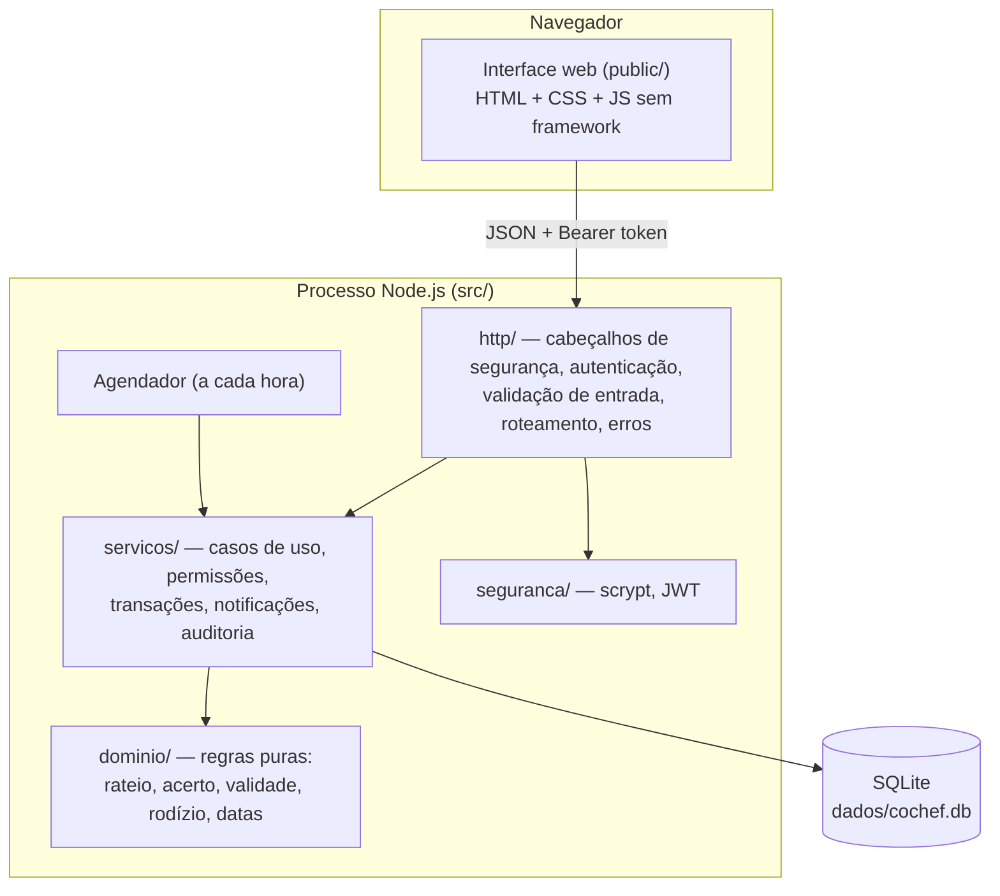

# Plano técnico — CoChef

Como a [spec.md](spec.md) vira software. Cada decisão estrutural aponta para o ADR que a justifica; as tarefas derivadas estão em [tasks.md](tasks.md).

## 1. Visão geral

Um único processo Node.js serve a API JSON e os arquivos estáticos da interface, e grava em um arquivo SQLite. Não há dependências externas em tempo de execução.



| Decisão | Escolha | Registro |
| :--- | :--- | :--- |
| Linguagem e plataforma | Node.js 22 + TypeScript executado nativamente, sem dependências | [ADR-001](docs/adr/0001-node-typescript-sem-dependencias.md) |
| Arquitetura | Monólito em camadas, com domínio puro | [ADR-002](docs/adr/0002-monolito-em-camadas.md) |
| Dados | SQLite; dinheiro em centavos inteiros; saldo derivado | [ADR-003](docs/adr/0003-sqlite-e-saldo-derivado.md) |
| Autenticação | JWT HS256 + scrypt; perfil relido a cada requisição | [ADR-004](docs/adr/0004-autenticacao-jwt-e-scrypt.md) |
| Automação | Rotinas idempotentes, agendadas e sob demanda | [ADR-005](docs/adr/0005-notificador-idempotente.md) |

## 2. Estrutura do código

```
src/
  dominio/      Regras puras, sem banco nem HTTP. Testáveis isoladamente.
    rateio.ts     RB-02, RB-05     acerto.ts   RB-03
    validade.ts   RF-03, RB-04     escala.ts   RF-11        datas.ts
  servicos/     Um arquivo por área do domínio; cada função pública é um caso de uso.
    auth.ts  republica.ts  estoque.ts  lista.ts  financas.ts  escala.ts
    rotinas.ts (ator Sistema)  notificacoes.ts  painel.ts  contexto.ts
  seguranca/    senha.ts (scrypt)  token.ts (JWT HS256)
  http/         app.ts (pipeline)  rotas.ts (tabela de rotas)  roteador.ts
  db.ts         Esquema, restrições e transações
  validacao.ts  Validação de entrada na fronteira HTTP
  config.ts  relogio.ts  erros.ts  servidor.ts
public/         index.html  estilo.css  app.js
tests/          dominio · auth · estoque · financas · escala
scripts/seed.ts Dados de demonstração
```

**Regras de dependência** (o que mantém spec e código alinhados):

1. `dominio/` não importa nada de fora de `dominio/`.
2. `servicos/` é o único lugar que decide permissões e abre transações. Toda função recebe o `Usuario` autenticado e filtra por `republicaId` (RNF-06).
3. `http/` só valida formato e delega. Nenhuma regra de negócio em rotas.
4. A interface nunca é a única barreira: tudo que ela esconde, o servidor também recusa.
5. O tempo entra por `Relogio`, injetado. Nenhum serviço chama `new Date()`; os testes controlam "hoje".

## 3. Modelo de dados

Treze tabelas, descritas em [`src/db.ts`](src/db.ts) e modeladas na [seção 8 da spec](spec.md#8-modelo-de-domínio). Invariantes impostas pelo próprio banco:

| Invariante | Mecanismo |
| :--- | :--- |
| Item individual tem dono; coletivo não | `CHECK` em `produto` |
| Uma sugestão pendente por produto (RF-04) | índice único parcial em `item_lista` |
| Um turno por dia e tipo; um fechamento por mês | `UNIQUE` |
| Notificação não se repete | `UNIQUE (usuario_id, chave)` + `INSERT OR IGNORE` |
| Valores e quantidades não negativos; estados válidos | `CHECK` |
| Integridade referencial | `PRAGMA foreign_keys = ON` |

O saldo não é armazenado: é calculado a partir de compras aprovadas, cotas e acertos pagos, o que impede que um contador fique fora de sincronia com os lançamentos.

## 4. API

Prefixo `/api`. Toda rota exige `Authorization: Bearer <token>`, exceto as de `/api/auth`. Erros têm o formato `{ "erro": { "codigo", "mensagem" } }`.

| Método e rota | Requisito | Perfil |
| :--- | :--- | :--- |
| `POST /auth/registro` · `POST /auth/login` | RF-13 | público |
| `GET /eu` · `GET /painel` | RF-03 | morador |
| `GET /republica` · `POST /republica/convite` · `PATCH /moradores/:id` · `GET /auditoria` | RF-12, RNF-07 | leitura: morador; demais: admin |
| `GET /produtos` · `POST /produtos` · `PATCH /produtos/:id` | RF-01 | morador (RB-01) |
| `POST /produtos/:id/consumo` · `/reposicao` · `/descarte` · `GET /consumos` | RF-02, RF-07, RF-14 | morador (RB-01) |
| `GET /lista` · `POST /lista` · `POST /lista/:id/comprado` · `DELETE /lista/:id` | RF-04, RF-16 | morador |
| `GET /compras` · `POST /compras` | RF-05, RF-08 | morador |
| `POST /compras/:id/aprovacao` · `/rejeicao` | RF-08 | admin |
| `GET /balanco` | RF-05, RB-03 | morador |
| `POST /fechamentos` | RF-09 | admin |
| `POST /acertos/:id/confirmacao` | RF-10 | credor ou admin |
| `GET /escala` · `POST /turnos/:id/conclusao` | RF-15 | morador |
| `POST /escala` | RF-11 | admin |
| `POST /trocas` · `/trocas/:id/aceite` · `/recusa` · `/cancelamento` | RF-06 | morador (partes da troca) |
| `GET /notificacoes` · `POST /notificacoes/lidas` · `/notificacoes/:id/lida` | RF-03 | morador |
| `GET /saude` (fora de `/api`) | RNF-03 | público |

Códigos de status: `400` entrada malformada · `401` sem sessão · `403` sem permissão (inclui RB-01) · `404` inexistente ou de outra república · `409` estado não permite a ação · `422` regra de negócio violada · `429` excesso de tentativas de login.

## 5. Fases de entrega

| Fase | Entrega | Critério de pronto |
| :--- | :--- | :--- |
| 0. Fundação | Estrutura, banco, relógio injetável, pipeline HTTP, CI | `npm test` e `npm run typecheck` verdes no CI |
| 1. Contas | Cadastro, convite, login, perfis, isolamento | Testes de RF-13, RNF-02, RNF-06 |
| 2. Estoque | Cadastro, baixa, reposição, validade, lista de compras | Testes de RF-01 a RF-04, RF-07, RF-14, RF-16, RB-01, RB-04 |
| 3. Finanças | Compras, aprovação, rateio, balanço, fechamento, acerto | Testes de RF-05, RF-08 a RF-10, RB-02, RB-03, RB-05, RB-08, RB-09 |
| 4. Escala | Geração, conclusão, troca, gestão de moradores | Testes de RF-06, RF-11, RF-12, RF-15, RB-06, RB-07, RB-10 |
| 5. Interface | Telas mobile-first para todos os fluxos | Inspeção em 360 px sem rolagem horizontal nem erro de console |
| 6. Revisão | Revisão multidimensional, correções, documentação | Achados em `docs/review/` com ação registrada |

## 6. Estratégia de verificação

Resumo; detalhes em [docs/testes.md](docs/testes.md).

- **Unidade** nas regras puras (`dominio/`, `seguranca/`), incluindo propriedades (a soma das cotas é sempre o valor da compra; as transferências sempre zeram os saldos).
- **Integração de ponta a ponta na API**: cada teste sobe a aplicação inteira com SQLite em memória e relógio fixo, e exerce o requisito por HTTP, como a interface faria.
- **Todo teste carrega o identificador do requisito no nome**, o que alimenta a matriz de rastreabilidade da spec.
- **Como dirigimos o agente de codificação:** uma tarefa de `tasks.md` por vez; o agente recebe o requisito EARS e as regras citadas, escreve primeiro o teste com o identificador no nome, depois o código; a revisão humana confere a linha correspondente da matriz de rastreabilidade antes de aprovar o pull request.

## 7. Riscos e limitações conhecidas

| Risco ou limitação | Tratamento |
| :--- | :--- |
| `node:sqlite` e a execução nativa de TypeScript são recursos recentes do Node | Versão mínima fixada em `package.json` (`>=22.18`); acesso ao banco isolado em `db.ts` |
| Um produto tem uma única validade (sem lotes) | Reposição pede a validade do novo lote; lotes estão no backlog (US-16) |
| Escrita concorrente limitada (SQLite, um processo) | Adequado à carga de uma república; migração descrita no ADR-003 |
| Notificações só dentro do aplicativo | Backlog (US-17) |
| Sem recuperação de senha | Registrado na [revisão de segurança](docs/review/seguranca.md) |
