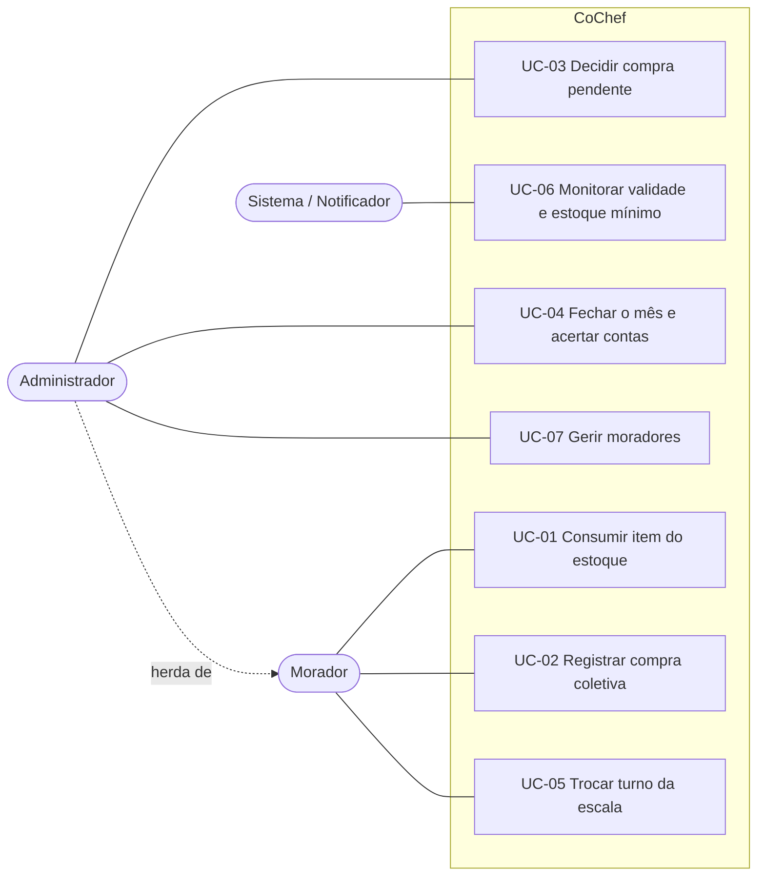
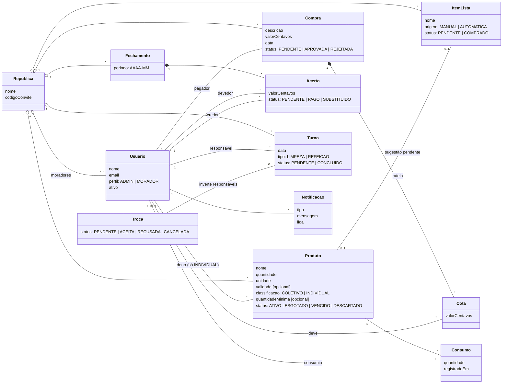
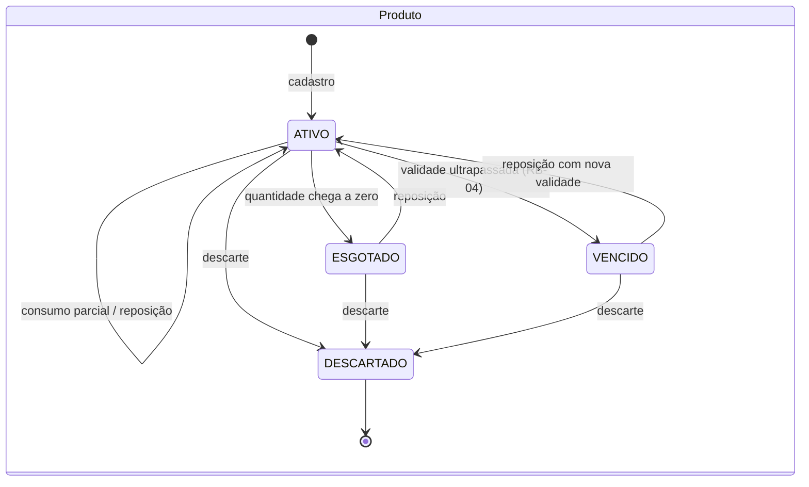
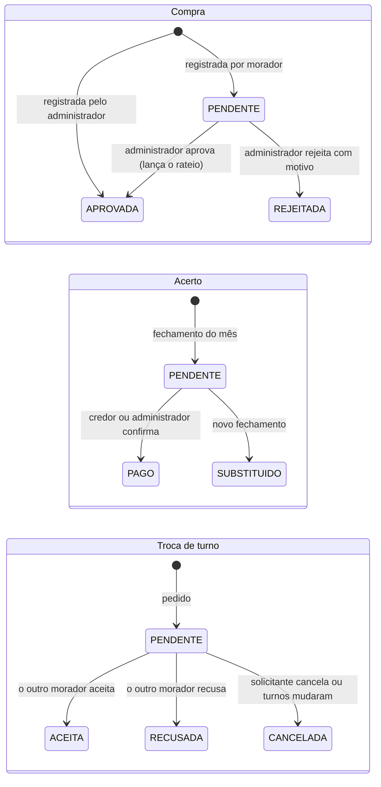
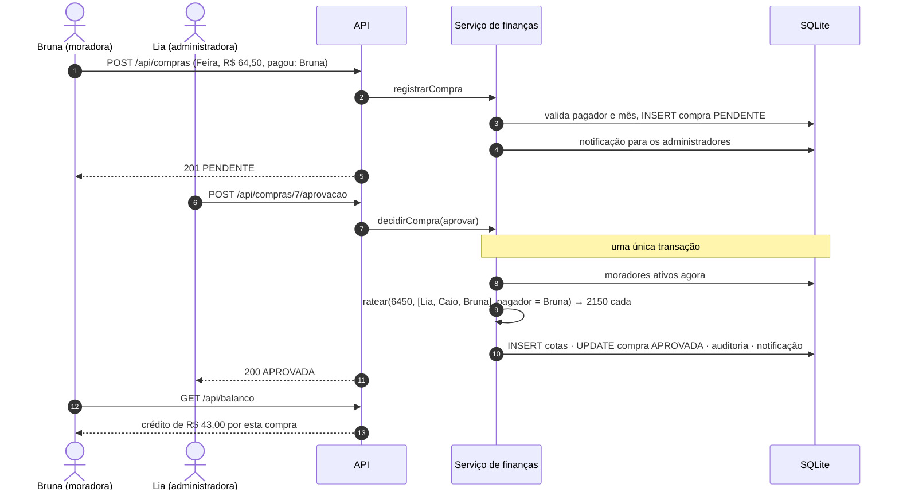

# Especificação — Cozinha de República (CoChef)

> Fonte única de verdade do que o sistema faz. Mudou uma decisão ou um requisito, este arquivo muda no mesmo pull request que o código (ver [Histórico de mudanças](#10-histórico-de-mudanças)).
> Decisões técnicas ficam em [plan.md](plan.md) e nos [ADRs](docs/adr/); termos do domínio, no [glossário](docs/glossario.md).

**Sumário:** [1. Problema](#1-problema-e-escopo) · [2. Personas](#2-personas-e-perfis) · [3. Requisitos funcionais](#3-requisitos-funcionais-rf) · [4. Requisitos não funcionais](#4-requisitos-não-funcionais-rnf) · [5. Regras de negócio](#5-regras-de-negócio-rb) · [6. Backlog](#6-backlog) · [7. Casos de uso](#7-casos-de-uso) · [8. Modelo de domínio](#8-modelo-de-domínio) · [9. Rastreabilidade](#9-rastreabilidade) · [10. Histórico](#10-histórico-de-mudanças)

---

## 1. Problema e escopo

Em moradias compartilhadas, a cozinha concentra três atritos recorrentes: comida que estraga ou é comprada em dobro porque ninguém sabe o que há no armário; discussão sobre quem pagou o quê nas compras coletivas; e incerteza sobre de quem é a vez de limpar ou cozinhar. Hoje cada atrito é tratado em uma ferramenta diferente (ver [benchmark](docs/benchmark.md)), e nenhuma liga o estoque ao dinheiro.

O CoChef trata a cozinha como um único fluxo: **estoque → lista de compras → compra coletiva → rateio → acerto**, com a **escala de tarefas** ao lado.

| Dentro do escopo (MVP, implementado) | Fora do escopo |
| :--- | :--- |
| Estoque com classificação coletivo/individual, validade e alertas | Pagamento dentro do sistema (PIX/gateway): o acerto é confirmado manualmente |
| Lista de compras manual e automática (estoque mínimo) | Integração com supermercados |
| Compras coletivas com aprovação, rateio e fechamento mensal | Recomendação de receitas por IA — o projeto **não usa IA/LLM** (restrição 3.5 não se aplica) |
| Escala rotativa de limpeza e refeição, com troca de turnos | Vários lotes com validades diferentes para o mesmo produto |
| Notificações dentro do aplicativo | Notificações por push, e-mail ou WhatsApp |

## 2. Personas e perfis

| Persona | Quem é | O que quer | O que a incomoda hoje |
| :--- | :--- | :--- | :--- |
| **Lia, a responsável pela casa** (23, último ano de Engenharia; mora há 3 anos na república) | Organiza as contas da casa em uma planilha e cobra os outros pelo grupo de mensagens. | Fechar o mês em minutos, com um número por pessoa que ninguém conteste. | Refazer contas quando alguém lembra de uma compra antiga; ser a "chata" que cobra. |
| **Caio, o calouro** (18, primeiro ano; recém-chegado) | Nunca dividiu casa. Tem pouco dinheiro e compra itens só para si. | Saber o que pode usar, o que é dele e de quem é a vez de limpar. | Ter a comida dele consumida por outros; pagar por coisas que não usou. |
| **Bruna, a que quase não para em casa** (26, trabalha e faz pós à noite) | Faz o mercado no caminho de volta e cozinha no fim de semana. | Abrir o celular no mercado e ver o que falta; trocar o turno quando o trabalho aperta. | Comprar o que já tinha; descobrir no dia que era a vez dela. |

**Perfis de acesso** (restrição 3.1):

| Perfil | Corresponde a | Pode | Não pode |
| :--- | :--- | :--- | :--- |
| **Morador** | Caio, Bruna | Movimentar o estoque coletivo e os próprios itens individuais; editar a lista de compras; registrar compras (ficam pendentes); cumprir e trocar os próprios turnos; confirmar pagamentos que recebeu. | Aprovar compras, fechar o mês, gerar escala, gerir moradores, ver o código de convite. |
| **Administrador** | Lia | Tudo que o morador pode, mais: aprovar/rejeitar compras, fechar o mês, gerar a escala, promover/desativar moradores, gerar código de convite, consultar a auditoria. | Movimentar item individual de outro morador (RB-01); aceitar troca em nome de outro; confirmar pagamento em que é o devedor. |
| **Sistema (notificador)** | Ator interno | Marcar produtos vencidos, emitir alertas de validade, sugerir compras e lembrar turnos. | — |

## 3. Requisitos funcionais (RF)

Notação EARS. Os identificadores são estáveis: um requisito alterado mantém o número e ganha uma linha no histórico.

### Estoque e lista de compras

- **RF-01 — Cadastro e classificação de estoque** *(event-driven)*
  **WHEN** o morador cadastrar um novo produto no estoque, **THE SYSTEM SHALL** registrar o nome, a quantidade, a unidade, a data de validade (quando o produto tiver) e a classificação do item (*Uso Coletivo* ou *Uso Individual*), atribuindo ao morador a propriedade do item quando a classificação for *Uso Individual*.
  - *(unwanted)* **IF** a data de validade informada for anterior ao dia atual, **THEN THE SYSTEM SHALL** recusar o cadastro.

- **RF-02 — Baixa/consumo de alimentos** *(event-driven)*
  **WHEN** o morador registrar o consumo de um item estocado, **THE SYSTEM SHALL** decrementar a quantidade em estoque e acrescentar o consumo ao histórico da república.
  - *(unwanted)* **IF** a quantidade informada for maior que a quantidade em estoque, **THEN THE SYSTEM SHALL** recusar a baixa e informar a quantidade disponível.
  - *(event-driven)* **WHEN** a quantidade de um produto chegar a zero, **THE SYSTEM SHALL** marcá-lo como *Esgotado*.

- **RF-03 — Alerta automatizado de validade** *(state-driven)*
  **WHILE** houver produtos ativos em *Validade Crítica* (vencimento a 3 dias ou menos do dia atual), **THE SYSTEM SHALL** exibi-los em destaque no painel principal.
  - *(event-driven)* **WHEN** um produto entrar em *Validade Crítica*, **THE SYSTEM SHALL** enviar uma única notificação a todos os moradores ativos, se o item for coletivo, ou apenas ao dono, se for individual.

- **RF-04 — Sugestão automática na lista de compras** *(event-driven)*
  **WHEN** um produto de *Uso Coletivo* atingir a quantidade mínima de segurança cadastrada, **THE SYSTEM SHALL** incluir automaticamente o item na lista de compras coletiva e notificar os moradores ativos.
  - *(state-driven)* **WHILE** já existir uma sugestão pendente para o produto, **THE SYSTEM SHALL** manter apenas essa sugestão, sem duplicá-la.

- **RF-07 — Baixa de item alheio** *(unwanted behavior)*
  **IF** um morador tentar dar baixa, editar, repor ou descartar um produto de *Uso Individual* pertencente a outro morador, **THEN THE SYSTEM SHALL** bloquear a ação e exibir uma mensagem informando a restrição de propriedade.

- **RF-14 — Reposição de estoque** *(event-driven)*
  **WHEN** o morador registrar a reposição de um produto, **THE SYSTEM SHALL** somar a quantidade ao estoque, reativar o produto e, se a quantidade ultrapassar o mínimo, marcar como comprada a sugestão pendente na lista de compras.
  - *(unwanted)* **IF** o produto estiver vencido ou esgotado, tiver validade e a reposição não informar a nova validade, **THEN THE SYSTEM SHALL** recusar a reposição.

- **RF-16 — Lista de compras manual** *(event-driven)*
  **WHEN** o morador adicionar um item à lista de compras ou marcá-lo como comprado, **THE SYSTEM SHALL** registrar a alteração com o autor e torná-la visível a todos os moradores da república.
  - *(unwanted)* **IF** um morador que não é administrador tentar remover um item que não foi adicionado por ele, **THEN THE SYSTEM SHALL** bloquear a remoção.

### Finanças

- **RF-05 — Registro e rateio de compras coletivas** *(event-driven)*
  **WHEN** o administrador registrar uma compra coletiva informando descrição, valor total, data e pagador, **THE SYSTEM SHALL** dividir o valor entre os moradores ativos (RB-02, RB-05), recalcular o saldo individual de cada um e registrar os débitos e créditos no acerto financeiro.
  - *(unwanted)* **IF** o pagador não for um morador ativo da república, a data estiver no futuro ou pertencer a um mês já fechado, **THEN THE SYSTEM SHALL** recusar o registro.

- **RF-08 — Aprovação de compras** *(event-driven)*
  **WHEN** um morador que não é administrador registrar uma compra coletiva, **THE SYSTEM SHALL** guardá-la como *Pendente*, sem alterar saldos, e notificar os administradores.
  - **WHEN** o administrador aprovar uma compra pendente, **THE SYSTEM SHALL** efetuar o rateio de RF-05 e notificar quem a registrou.
  - **WHEN** o administrador rejeitar uma compra pendente informando o motivo, **THE SYSTEM SHALL** marcá-la como *Rejeitada*, sem alterar saldos, e notificar quem a registrou.
  - *(unwanted)* **IF** um usuário sem perfil de administrador tentar aprovar ou rejeitar uma compra, **THEN THE SYSTEM SHALL** bloquear a ação.

- **RF-09 — Fechamento mensal** *(event-driven)*
  **WHEN** o administrador fechar um mês, **THE SYSTEM SHALL** gerar os acertos ("quem deve quanto para quem") a partir dos saldos correntes, notificar os devedores e impedir novos lançamentos com data naquele mês.
  - *(unwanted)* **IF** houver compras pendentes de aprovação com data até o fim do mês, ou o mês já estiver fechado ou ainda não tiver começado, **THEN THE SYSTEM SHALL** recusar o fechamento.

- **RF-10 — Confirmação de acerto** *(event-driven)*
  **WHEN** o credor de um acerto ou o administrador confirmar o recebimento, **THE SYSTEM SHALL** marcar o acerto como *Pago* e atualizar os saldos de devedor e credor.
  - *(unwanted)* **IF** o próprio devedor tentar confirmar o pagamento, **THEN THE SYSTEM SHALL** bloquear a ação.

### Escala

- **RF-11 — Geração da escala rotativa** *(event-driven)*
  **WHEN** o administrador gerar a escala para um intervalo de dias, **THE SYSTEM SHALL** atribuir os turnos de limpeza e de refeição aos moradores ativos em rodízio, continuando a ordem a partir do último turno existente e preservando os turnos já atribuídos.

- **RF-06 — Troca de turnos** *(event-driven)*
  **WHEN** um morador solicitar a troca de um turno seu por um turno de outro morador e este aceitar, **THE SYSTEM SHALL** registrar a substituição e atualizar o calendário compartilhado da casa.
  - *(unwanted)* **IF** qualquer dos turnos já tiver sido concluído, já tiver passado ou tiver mudado de responsável desde o pedido, **THEN THE SYSTEM SHALL** recusar a troca.

- **RF-15 — Cumprimento de turno** *(event-driven)*
  **WHEN** o responsável marcar um turno como cumprido, **THE SYSTEM SHALL** registrá-lo como *Concluído*.
  - *(state-driven)* **WHILE** um turno do dia atual estiver pendente, **THE SYSTEM SHALL** manter um lembrete para o responsável.
  - *(unwanted)* **IF** alguém que não é o responsável tentar concluir o turno, ou o turno for de um dia futuro, **THEN THE SYSTEM SHALL** bloquear a ação.

### Conta e república

- **RF-13 — Cadastro e ingresso** *(event-driven)*
  **WHEN** uma pessoa se cadastrar informando o nome de uma nova república, **THE SYSTEM SHALL** criar a república e a conta com perfil de administrador.
  - **WHEN** uma pessoa se cadastrar informando um código de convite válido, **THE SYSTEM SHALL** criar a conta com perfil de morador naquela república.

- **RF-12 — Gestão de moradores** *(event-driven)*
  **WHEN** o administrador desativar um morador, **THE SYSTEM SHALL** encerrar imediatamente o acesso dele, removê-lo dos turnos futuros pendentes e excluí-lo dos rateios e escalas seguintes.
  - *(unwanted)* **IF** o morador tiver saldo diferente de zero (RB-07) ou a alteração deixar a república sem administrador ativo (RB-06), **THEN THE SYSTEM SHALL** recusar a alteração.

## 4. Requisitos não funcionais (RNF)

- **RNF-01 — Desempenho** *(ubiquitous)*: **THE SYSTEM SHALL** responder às consultas de estoque e saldo financeiro em menos de 1,5 segundo sob carga normal (república com até 2.000 produtos e 500 compras registradas).
- **RNF-02 — Proteção de credenciais** *(ubiquitous)*: **THE SYSTEM SHALL** armazenar as senhas dos usuários como hash *scrypt* com *salt* aleatório por usuário e exigir token JWT válido em todas as requisições privadas da API. *(Alterado: ver [ADR-004](docs/adr/0004-autenticacao-jwt-e-scrypt.md).)*
- **RNF-03 — Disponibilidade** *(ubiquitous)*: **THE SYSTEM SHALL** manter disponibilidade mínima de 99,0%, calculada mensalmente.
- **RNF-04 — Usabilidade mobile-first** *(state-driven)*: **WHILE** o sistema estiver sendo acessado em dispositivos móveis, **THE SYSTEM SHALL** adaptar a interface a telas com largura a partir de 360 px, sem perda de funcionalidade nem sobreposição de componentes.
- **RNF-05 — Persistência e integridade** *(ubiquitous)*: **THE SYSTEM SHALL** persistir todos os dados em armazenamento durável e executar cada operação de negócio de forma atômica, de modo que uma falha no meio da operação não deixe dados parciais.
- **RNF-06 — Isolamento entre repúblicas** *(ubiquitous)*: **THE SYSTEM SHALL** restringir toda leitura e escrita aos dados da república do usuário autenticado.
- **RNF-07 — Auditabilidade** *(event-driven)*: **WHEN** uma ação financeira ou administrativa for concluída, **THE SYSTEM SHALL** registrar em trilha de auditoria quem a executou, quando e sobre o quê.

## 5. Regras de negócio (RB)

Regras do domínio, independentes de tecnologia. Cada uma é imposta no servidor; a interface apenas as antecipa.

| ID | Regra | Onde é imposta |
| :--- | :--- | :--- |
| **RB-01** | **Propriedade individual.** Produto de *Uso Individual* pertence exclusivamente a quem o cadastrou. Ninguém mais — nem o administrador — pode consumi-lo, alterá-lo, repô-lo ou descartá-lo. | `servicos/estoque.ts` (`exigirPropriedade`); restrição `CHECK` na tabela `produto` |
| **RB-02** | **Divisão igualitária.** O valor de uma compra coletiva é dividido em partes iguais entre todos os moradores ativos no momento do lançamento. Lançamento é o instante em que a compra passa a valer: o registro, se feito pelo administrador; a aprovação, se feito por morador. | `dominio/rateio.ts`, `servicos/financas.ts` (`lancarRateio`) |
| **RB-03** | **Compensação implícita de saldos.** Cada morador tem um único saldo líquido com a casa. O que ele paga em uma compra abate primeiro o que devia de compras anteriores; só o excedente vira crédito. | `servicos/financas.ts` (`calcularSaldos`), `dominio/acerto.ts` |
| **RB-04** | **Vencido não se consome.** Item cuja validade foi ultrapassada passa a *Vencido*, sai do estoque ativo e não pode mais ser selecionado para consumo. No dia do vencimento o item ainda é consumível. | `servicos/rotinas.ts`, `servicos/estoque.ts` |
| **RB-05** | **Centavos residuais.** Valores são inteiros em centavos. Se a divisão não for exata, os centavos restantes ficam na cota do pagador, e a soma das cotas é sempre igual ao valor da compra. | `dominio/rateio.ts` |
| **RB-06** | **Sempre há um administrador.** A república nunca fica sem ao menos um administrador ativo. | `servicos/republica.ts` |
| **RB-07** | **Sair com as contas em dia.** Morador com saldo diferente de zero, ou com compra aguardando aprovação em que é o pagador, não pode ser desativado. | `servicos/republica.ts` |
| **RB-08** | **Mês fechado é imutável.** Depois do fechamento, o mês não aceita registro nem aprovação de compras. Um novo fechamento substitui os acertos ainda pendentes dos anteriores, porque o saldo corrente já os contém. | `servicos/financas.ts` |
| **RB-09** | **Quem deve não dá quitação.** O pagamento de um acerto só é confirmado por quem recebe ou pelo administrador, e nunca pelo próprio devedor. | `servicos/financas.ts` (`confirmarAcerto`) |
| **RB-10** | **Troca exige os dois.** Uma troca de turnos só se efetiva com o pedido de um morador e o aceite do outro; ninguém aceita em nome de terceiros. Cada turno participa de no máximo um pedido em aberto. | `servicos/escala.ts` |

## 6. Backlog

Prioridade MoSCoW. Estado em 11/10/2026: todos os itens *Must* e *Should* estão implementados e cobertos por teste.

| ID | História | Requisitos | Prioridade | Estado |
| :--- | :--- | :--- | :--- | :--- |
| US-01 | Como pessoa que acabou de chegar, quero criar a república ou entrar com um convite, para usar o sistema com a minha casa. | RF-13 | Must | Feito |
| US-02 | Como morador, quero cadastrar o que comprei como coletivo ou individual, para que todos saibam o que há e de quem é. | RF-01, RB-01 | Must | Feito |
| US-03 | Como morador, quero dar baixa no que consumi, para o estoque refletir a realidade. | RF-02 | Must | Feito |
| US-04 | Como Caio, quero que ninguém consiga dar baixa nos meus itens individuais, para não ficar sem a minha comida. | RF-07, RB-01 | Must | Feito |
| US-05 | Como morador, quero ser avisado do que está perto de vencer, para consumir antes de estragar. | RF-03, RB-04 | Must | Feito |
| US-06 | Como Bruna, quero que itens coletivos em falta entrem sozinhos na lista de compras, para saber o que comprar no mercado. | RF-04, RF-14, RF-16 | Must | Feito |
| US-07 | Como morador, quero registrar uma compra coletiva que paguei, para ser ressarcido. | RF-05, RF-08 | Must | Feito |
| US-08 | Como Lia, quero aprovar ou rejeitar compras antes de entrarem no rateio, para que só despesas coletivas de verdade sejam divididas. | RF-08 | Must | Feito |
| US-09 | Como morador, quero ver meu saldo e quem deve para quem, para saber quanto pagar ou receber. | RF-05, RB-02, RB-03, RB-05 | Must | Feito |
| US-10 | Como Lia, quero fechar o mês e acompanhar os pagamentos, para encerrar as contas sem planilha. | RF-09, RF-10, RB-08, RB-09 | Must | Feito |
| US-11 | Como Lia, quero gerar a escala de limpeza e de refeição em rodízio, para a divisão ser justa. | RF-11 | Must | Feito |
| US-12 | Como Bruna, quero trocar meu turno com outro morador, para ajustar a escala à minha semana. | RF-06, RB-10 | Should | Feito |
| US-13 | Como morador, quero marcar meu turno como cumprido e ser lembrado no dia, para não esquecer. | RF-15 | Should | Feito |
| US-14 | Como Lia, quero desativar quem saiu da casa e passar a administração adiante, para manter a república em ordem. | RF-12, RB-06, RB-07 | Should | Feito |
| US-15 | Como Lia, quero consultar quem aprovou, fechou ou alterou o quê, para resolver dúvidas sem discussão. | RNF-07 | Should | Feito |
| US-16 | Como morador, quero controlar lotes com validades diferentes do mesmo produto. | — | Could | Não iniciado |
| US-17 | Como morador, quero receber os avisos por push ou e-mail. | — | Could | Não iniciado |
| US-18 | Como morador, quero pagar o acerto por PIX dentro do aplicativo. | — | Won't (neste ciclo) | Fora do escopo |

## 7. Casos de uso

### UC-01 — Consumir item do estoque
- **Ator:** Morador. **Requisitos:** RF-02, RF-04, RF-07, RB-01, RB-04.
- **Pré-condição:** morador autenticado e ativo; produto existe na república dele.
- **Fluxo principal:** (1) o morador escolhe o produto e informa a quantidade; (2) o sistema atualiza a situação de validade do estoque; (3) confere a propriedade, a situação e a quantidade; (4) decrementa o estoque e registra o consumo; (5) se o produto coletivo atingiu o mínimo, inclui-o na lista de compras e notifica a casa.
- **Fluxos de exceção:** (3a) item individual de outro morador → bloqueia e informa de quem é o item; (3b) produto vencido ou descartado → recusa; (3c) quantidade maior que o estoque → recusa e informa o disponível.
- **Pós-condição:** estoque e histórico consistentes; nenhuma alteração em caso de exceção.

### UC-02 — Registrar compra coletiva
- **Ator:** Morador ou Administrador. **Requisitos:** RF-05, RF-08, RB-02, RB-05, RB-08.
- **Fluxo principal (morador):** (1) informa descrição, valor, data e quem pagou; (2) o sistema valida pagador, data e mês; (3) guarda a compra como *Pendente*; (4) notifica os administradores.
- **Fluxo alternativo (administrador):** em (3), a compra já nasce *Aprovada* e o rateio é lançado na hora.
- **Exceções:** pagador inativo ou de outra casa; data futura; mês fechado.

### UC-03 — Decidir compra pendente
- **Ator:** Administrador. **Requisitos:** RF-08, RB-02, RB-03, RB-05.
- **Fluxo principal:** (1) o administrador abre a compra pendente; (2) aprova; (3) o sistema calcula as cotas entre os moradores ativos agora, com o resíduo na cota do pagador; (4) grava as cotas e a decisão na mesma transação; (5) registra na auditoria e notifica quem registrou.
- **Fluxo alternativo:** (2a) rejeita informando o motivo → nenhuma cota é criada.
- **Exceções:** compra já decidida; mês da compra fechado; pagador desativado desde o registro.

### UC-04 — Fechar o mês e acertar contas
- **Ator:** Administrador (fechamento); credor ou administrador (confirmação). **Requisitos:** RF-09, RF-10, RB-03, RB-08, RB-09.
- **Fluxo principal:** (1) o administrador escolhe o mês; (2) o sistema confere que não há compras pendentes até o fim do mês; (3) substitui acertos pendentes de fechamentos anteriores; (4) calcula o menor conjunto de transferências que zera os saldos; (5) grava os acertos e notifica os devedores; (6) cada devedor paga por fora; (7) quem recebeu confirma; (8) o sistema atualiza os saldos.
- **Exceções:** mês futuro ou já fechado; compras pendentes; devedor tentando confirmar o próprio pagamento.

### UC-05 — Trocar turno da escala
- **Atores:** dois Moradores. **Requisitos:** RF-06, RB-10.
- **Fluxo principal:** (1) o solicitante escolhe um turno de outro morador e oferece um turno seu; (2) o sistema valida os dois turnos e cria o pedido; (3) notifica o outro morador; (4) este aceita; (5) o sistema revalida, inverte os responsáveis e notifica o solicitante.
- **Fluxos alternativos:** (4a) o outro morador recusa; (4b) o solicitante cancela.
- **Exceções:** turno concluído, passado ou já envolvido em outro pedido; turnos alterados entre o pedido e o aceite → o pedido é cancelado.

### UC-06 — Monitorar validade e estoque mínimo
- **Ator:** Sistema (a cada hora e antes de toda consulta ou baixa de estoque). **Requisitos:** RF-03, RF-04, RF-15, RB-04.
- **Fluxo principal:** (1) marca como *Vencido* todo produto ativo com validade ultrapassada, notifica e, se coletivo com mínimo, devolve-o à lista; (2) notifica uma vez cada produto que entrou em validade crítica; (3) lembra os responsáveis pelos turnos de hoje.
- **Propriedade:** idempotente — repetir a rotina no mesmo dia não gera notificação nem item de lista duplicado.

### UC-07 — Gerir moradores
- **Ator:** Administrador. **Requisitos:** RF-12, RF-13, RB-06, RB-07.
- **Fluxo principal:** (1) o administrador gera um código de convite e o entrega a quem vai entrar; (2) a pessoa se cadastra com o código; (3) quando alguém sai, o administrador faz o fechamento, confirma os acertos e desativa a conta.
- **Exceções:** saldo em aberto; último administrador ativo.

## 8. Modelo de domínio

**Invariantes do modelo**

1. Produto *Individual* tem dono e não tem quantidade mínima; produto *Coletivo* não tem dono.
2. A soma das cotas de uma compra aprovada é igual ao valor da compra; compras pendentes ou rejeitadas não têm cotas.
3. A soma dos saldos de todos os moradores de uma república é sempre zero.
4. Existe no máximo uma sugestão pendente na lista por produto, um turno por (dia, tipo) e um fechamento por mês.
5. Todo dado pertence a exatamente uma república.

**Saldo de um morador** = total pago em compras aprovadas − soma das próprias cotas + acertos pagos como devedor − acertos pagos como credor.

### Comportamento

## 9. Rastreabilidade

Cada requisito aponta para o código que o implementa e para os testes que o verificam. Os testes citam o identificador do requisito no próprio nome, de modo que `npm test` mostra a cobertura da especificação. Detalhes e saída completa em [docs/testes.md](docs/testes.md).

| Requisito | Implementação | Verificação (`tests/`) |
| :--- | :--- | :--- |
| RF-01 | `servicos/estoque.ts` · `cadastrarProduto` | `estoque.test.ts` — "RF-01: …" (3 testes) |
| RF-02 | `servicos/estoque.ts` · `consumirProduto`, `historicoConsumo` | `estoque.test.ts` — "RF-02: …" (2) |
| RF-03 | `dominio/validade.ts`, `servicos/rotinas.ts`, `servicos/painel.ts` | `dominio.test.ts` — "RF-03 / glossário" (5); `estoque.test.ts` — "RF-03: …" (3) |
| RF-04 | `servicos/lista.ts` · `sugerirReposicao`; `servicos/estoque.ts` · `verificarMinimo` | `estoque.test.ts` — "RF-04: …" (3) |
| RF-05 | `servicos/financas.ts` · `registrarCompra`, `calcularSaldos` | `financas.test.ts` — "RF-05 …" (2), "quem deve para quem" |
| RF-06 | `servicos/escala.ts` · `solicitarTroca`, `responderTroca`, `cancelarTroca` | `escala.test.ts` — "RF-06: …" (4) |
| RF-07 | `servicos/estoque.ts` · `exigirPropriedade` | `estoque.test.ts` — "RF-07 / RB-01", "RB-01: outro morador também não…" |
| RF-08 | `servicos/financas.ts` · `registrarCompra`, `decidirCompra` | `financas.test.ts` — "RF-08: …" (4) |
| RF-09 | `servicos/financas.ts` · `fecharPeriodo` | `financas.test.ts` — "RF-09: …" (3) |
| RF-10 | `servicos/financas.ts` · `confirmarAcerto` | `financas.test.ts` — "RF-10: …" |
| RF-11 | `dominio/escala.ts`, `servicos/escala.ts` · `gerarEscala` | `dominio.test.ts` — "RF-11" (3); `escala.test.ts` — "RF-11: …" (4) |
| RF-12 | `servicos/republica.ts` · `alterarMorador`; `servicos/auth.ts` · `autenticar` | `escala.test.ts` — "RF-12 …" (3) |
| RF-13 | `servicos/auth.ts` · `registrar`, `entrar` | `auth.test.ts` — "quem cria a república…", "cadastro exige…", "convite regenerado…" |
| RF-14 | `servicos/estoque.ts` · `reporProduto` | `estoque.test.ts` — "RF-04 + reposição", "reposição de produto vencido…" |
| RF-15 | `servicos/escala.ts` · `concluirTurno`; `servicos/rotinas.ts` | `escala.test.ts` — "conclusão de turno…", "turno de hoje pendente…" |
| RF-16 | `servicos/lista.ts` | `estoque.test.ts` — "lista de compras manual…" |
| RNF-01 | índices em `db.ts`; consultas agregadas em `financas.ts` | `estoque.test.ts` — "RNF-01: desempenho" (2.000 produtos, 500 compras) |
| RNF-02 | `seguranca/senha.ts`, `seguranca/token.ts`, `http/app.ts` | `dominio.test.ts` — "RNF-02" (4); `auth.test.ts` — "RNF-02: …" (2), "token expira" |
| RNF-03 | `/saude`, encerramento limpo e WAL (`servidor.ts`, `db.ts`) | Não verificável por teste automatizado: medido em operação (ver [revisão de observabilidade](docs/review/observabilidade.md)) |
| RNF-04 | `public/estilo.css` | Inspeção em 360 px e 1280 px ([evidências](docs/evidencias/)) |
| RNF-05 | `db.ts` · `transacao`; restrições `CHECK`/`UNIQUE`/`FOREIGN KEY` | `financas.test.ts` — "RB-05" (saldos somam zero); todos os testes de exceção conferem que nada mudou |
| RNF-06 | filtro por `republica_id` em todos os serviços | `auth.test.ts` — "isolamento: uma república não enxerga…" |
| RNF-07 | `servicos/contexto.ts` · `auditar` | `financas.test.ts` — "ações financeiras ficam na trilha de auditoria" |
| RB-01 | ver RF-07 | ver RF-07 |
| RB-02 | `dominio/rateio.ts` | `dominio.test.ts` — "RB-02 / RB-05" (4); `financas.test.ts` — "RB-02: o rateio considera quem está ativo…" |
| RB-03 | `servicos/financas.ts`, `dominio/acerto.ts` | `dominio.test.ts` — "RB-03" (4); `financas.test.ts` — "RB-03: o que o morador paga abate primeiro…" |
| RB-04 | `servicos/rotinas.ts` | `estoque.test.ts` — "RB-04: passada a validade…" |
| RB-05 | `dominio/rateio.ts` | `financas.test.ts` — "RB-05: divisão inexata…" |
| RB-06 | `servicos/republica.ts` | `escala.test.ts` — "RF-12 / RB-06" |
| RB-07 | `servicos/republica.ts` | `escala.test.ts` — "RF-12 / RB-07" |
| RB-08 | `servicos/financas.ts` | `financas.test.ts` — "RF-09: fechamento gera…", "RF-08 + RF-09", "novo fechamento substitui…" |
| RB-09 | `servicos/financas.ts` | `financas.test.ts` — "RF-10: …" |
| RB-10 | `servicos/escala.ts` | `escala.test.ts` — "RF-06: troca solicitada e aceita…", "regras do pedido" |

## 10. Histórico de mudanças

| Data | Mudança | Motivo |
| :--- | :--- | :--- |
| — | Versão inicial (`specs.md`): RF-01 a RF-07, RNF-01 a RNF-04, RB-01 a RB-04. | — |
| 11/10/2026 | **RF-03:** "inferior a 3 dias" → "3 dias ou menos". | A redação divergia do glossário (*Validade Crítica* = 3 dias ou menos). O glossário prevaleceu. |
| 11/10/2026 | **RF-01:** validade passa a ser opcional; cadastro de produto já vencido é recusado. | Produtos de limpeza e alguns secos não têm validade relevante. |
| 11/10/2026 | **RF-05** dividido: registro pelo administrador vale na hora; registro por morador exige aprovação (**RF-08**, novo). | O README já atribuía ao administrador "aprovar despesas coletivas", mas nenhum requisito descrevia a aprovação. |
| 11/10/2026 | **RF-06:** "dois moradores solicitarem" → pedido de um e aceite do outro. | A redação original não dizia como os dois manifestam a concordância. |
| 11/10/2026 | **RF-07:** bloqueio estendido de "dar baixa" para editar, repor e descartar. | Alinhamento com RB-01, que já proibia "alterar suas propriedades". |
| 11/10/2026 | Novos: **RF-09** a **RF-16**, **RNF-05** a **RNF-07**, **RB-05** a **RB-10**. | Fluxos que o escopo do README previa (fechamento, escala, gestão de moradores) e regras descobertas na implementação. |
| 11/10/2026 | **RNF-02:** *bcrypt* → *scrypt*. | [ADR-004](docs/adr/0004-autenticacao-jwt-e-scrypt.md): sistema sem dependências externas; scrypt faz parte da biblioteca padrão. |
| 11/10/2026 | **RB-02:** definido "momento do lançamento" como o da efetivação. **RB-03:** reescrita em termos de saldo líquido. **RB-04:** título corrigido ("Incapaz de Consumo…" → "Vencido não se consome"). | Ambiguidades da redação original. |
